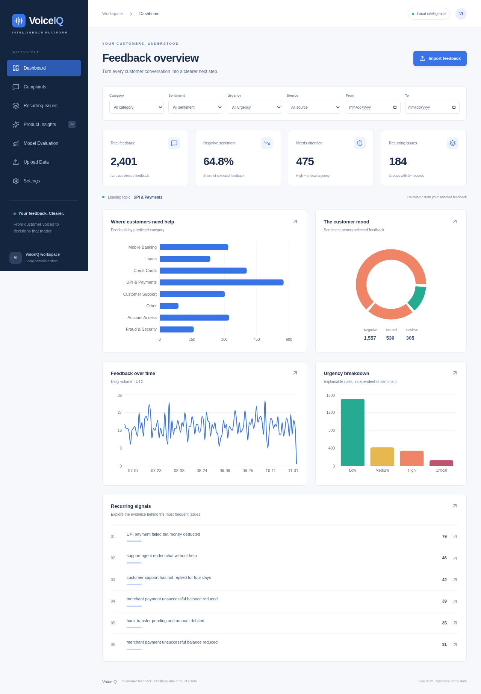
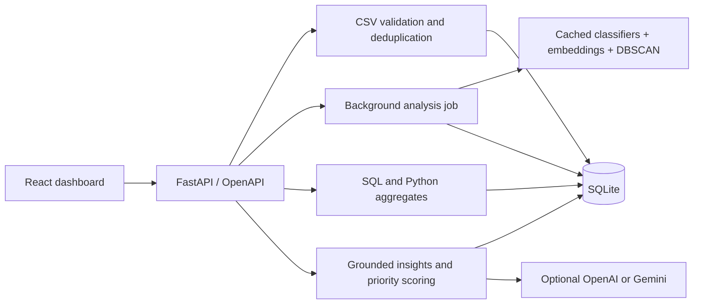

# VoiceIQ — AI Customer Feedback Intelligence

A local, interview-ready portfolio MVP for turning banking feedback into searchable evidence, recurring issues and prioritized product opportunities. Designed for product managers, support leads and analysts.

VoiceIQ runs without a paid API key. It uses **trained ML models**, persisted SQLite records and real HTTP APIs. Optional OpenAI and Gemini integrations add validated, evidence-linked generation. Deterministic summaries and lexical clustering are explicitly labeled.



## What you can do

- Import UTF-8 CSV with row-level validation, size limits, transactional writes and duplicate detection.
- Run a background analysis job with progress, failure reporting and retry.
- Predict eight complaint categories and three sentiments with TF-IDF + Logistic Regression; inspect confidence and model version.
- Inspect explainable urgency rules independently of sentiment.
- Group recurring complaints with cosine DBSCAN using cached sentence-transformer embeddings, or an explicit TF-IDF lexical fallback.
- Filter server-calculated KPIs and five chart views by category, sentiment, urgency, date and source.
- Search, paginate and sort complaints; open complaint and cluster evidence dialogs.
- Generate recommendations with calculated priorities, proposed metrics, benefits and traceable IDs.
- Review independently phrased synthetic evaluation, confusion matrix and clustering diagnostics.

## Architecture

React 19, TypeScript, Vite, Tailwind CSS, Recharts, React Router and Lucide → FastAPI/Pydantic services → SQLAlchemy/SQLite. pandas, NumPy, scikit-learn and optional sentence-transformers power local ML. httpx implements both external AI adapters without requiring either provider SDK.



See [architecture](docs/ARCHITECTURE.md), [business workflows](docs/BUSINESS_WORKFLOWS.md), [API](docs/API.md), [ML design](docs/ML_DESIGN.md), [decisions](docs/DECISIONS.md) and [product case study](docs/PRODUCT_CASE_STUDY.md).

## Windows / VS Code setup

Prerequisites: **Python 3.12**, **Node.js 22.12+ or 24**, Git. Open PowerShell at the repository root. Commands use the virtual environment's executable directly, so PowerShell activation policy changes are unnecessary.

```powershell
python -m venv .venv
.\.venv\Scripts\python.exe -m pip install -r backend\requirements.txt
Copy-Item .env.example .env
npm --prefix frontend ci
.\.venv\Scripts\python.exe scripts\generate_data.py
.\.venv\Scripts\python.exe scripts\train.py
.\.venv\Scripts\python.exe scripts\seed.py
.\.venv\Scripts\python.exe scripts\evaluate.py
```

Copy `.env` only on first setup; preserve existing settings. Generation writes the reproducible synthetic datasets. Training saves local trusted joblib artifacts. **Seed is explicit and idempotent**: repeat IDs are skipped, and uploaded data is never removed. SQLite, models, embeddings, environments and dependencies are ignored by Git.

Start the backend in one terminal:

```powershell
.\.venv\Scripts\python.exe -m uvicorn app.main:app --app-dir backend --host 127.0.0.1 --port 8000 --no-access-log
```

Start the frontend in a second terminal:

```powershell
npm --prefix frontend run dev
```

Open the Vite address printed in your local terminal. API documentation is served by FastAPI at `/docs` on port 8000. Vite proxies `/api` to the backend. Use **one uvicorn worker**. Startup initializes missing tables but does not seed or overwrite user data. SQLite timestamps represent UTC.

## Semantic grouping (optional model download)

The default `EMBEDDING_MODE=tfidf` is an honest lexical fallback. To enable MiniLM semantic grouping:

```powershell
.\.venv\Scripts\python.exe -m pip install torch==2.9.1 --index-url https://download.pytorch.org/whl/cpu
.\.venv\Scripts\python.exe -m pip install -r backend\requirements-semantic.txt
.\.venv\Scripts\python.exe scripts\download_model.py
```

Set `EMBEDDING_MODE=sentence-transformer` in `.env`, restart the backend, and run analysis again to rebuild clusters. An opt-in real-model integration test is available after downloading the model:

```powershell
$env:VOICEIQ_RUN_SEMANTIC = "1"
.\.venv\Scripts\python.exe -m pytest backend\tests\test_semantic_integration.py -c backend\pytest.ini -q
Remove-Item Env:\VOICEIQ_RUN_SEMANTIC
```

Without this flag the integration test is explicitly skipped, not reported as verified. It loads only locally cached model files and checks embedding similarity, clustering and cache reuse.

The CPU model is `sentence-transformers/all-MiniLM-L6-v2` by default. Downloads require Hugging Face and its artifact hosts. Embeddings are cached by model identifier and normalized input text hash, including across server restarts. Model downloads use normal TLS verification; offline failures do not silently switch modes.

**Current cloud limitation:** package installation succeeded, but the Hugging Face model download was denied by the network policy. A draft adds `huggingface.co`, `cas-bridge.xethub.hf.co`, `cas-server.xethub.hf.co`, and `transfer.xethub.hf.co`. Apply these environment settings before retrying. Real sentence-transformer inference remains unverified in this session; lexical grouping is verified.

## Optional Gemini or OpenAI

Edit root `.env`; never commit keys. Use a model supported by your own account. No model identifier is guessed, and both keys are never required.

```dotenv
AI_PROVIDER=gemini
GEMINI_API_KEY=your-key-entered-locally
GEMINI_MODEL=your-supported-model
```

Or:

```dotenv
AI_PROVIDER=openai
OPENAI_API_KEY=your-key-entered-locally
OPENAI_MODEL=your-supported-chat-completions-model
```

Restart the backend. Settings reports configuration presence, **not proof of live account access**. Click Generate insights to explicitly refresh results. A bounded evidence sample (up to eight IDs/texts per issue, three external calls per generation) goes to the chosen provider. Configured models must support Gemini generateContent with JSON responseSchema, or OpenAI Chat Completions with JSON-object responses, respectively. No default model is assumed; unsupported models report a sanitized error and fall back. On restricted cloud networks, allow generativelanguage.googleapis.com for Gemini or api.openai.com for OpenAI before a live call.

Calls time out after 30 seconds each; simultaneous generations are rejected. Gemini requests include responseSchema and a bounded output-token budget. Responses must match a strict Pydantic schema and cite unique supplied complaint IDs. Missing credentials or invalid configuration leave the local workflow available with an explicit status message. Failures show warnings and retain deterministic summaries. Other clusters use deterministic summaries to keep generation bounded. The executive overview always uses calculated backend statistics.

Set `AI_PROVIDER=none` for the fully local workflow. Both adapters have mocked request/response and failure tests, including Gemini responseSchema requests, safety blocks, token truncation, quota errors and invalid evidence. No live generation was performed because credentials and compatible model names were not supplied. Automated evidence-ID checks cannot prove every generated claim: users must review AI hypotheses and recommendations.

Other configuration:

| Variable | Purpose |
| --- | --- |
| `DATABASE_URL` | Optional SQLAlchemy URL; defaults to repository `artifacts/voiceiq.db` |
| `CORS_ORIGINS` | Comma-separated allowed frontend origins; local port 5173 by default |
| `EMBEDDING_MODE` | `tfidf` or `sentence-transformer` |
| `EMBEDDING_MODEL` | Sentence-transformers model identifier; default MiniLM |

## Tests and evaluation

```powershell
.\.venv\Scripts\python.exe -m pytest backend\tests -c backend\pytest.ini -q
npm --prefix frontend test
npm --prefix frontend run build
.\.venv\Scripts\python.exe scripts\evaluate.py
```

With both servers running and seed data present:

```powershell
Set-Location frontend
npx playwright install chromium
npm run test:e2e
Set-Location ..
```

For an already installed Chromium, set `$env:CHROMIUM_PATH` to its executable before the browser test. The browser test imports one synthetic record (`BROWSER-001`) and deliberately invalid data; repeating it safely reports duplicates. It exercises all seven pages, real dashboard/filter requests, complaint/cluster dialogs, insight generation, CSV upload and background analysis, then captures `docs/dashboard.png`. It requires local no-key settings and at least the 2,400 seeded records.

Actual measurements are in [data/evaluation/results.json](data/evaluation/results.json); executed checks are recorded in [docs/VERIFICATION.md](docs/VERIFICATION.md). On 112 independent-phrase synthetic examples, category macro-F1 is **0.641**, sentiment macro-F1 **0.922**. These are not real-world or banking-domain validation. Training/demo records use separate sentence templates from evaluation. Review errors before trusting classifications on novel data. Category macro-F1 is unchanged from baseline; sentiment increased from 0.606 to 0.922 using word/character TF-IDF plus independent VADER valence features in a learned Logistic Regression model. A category candidate scored 0.628 and was rejected at the release regression gate. Training data and held-out examples are unchanged; see [ML finalization](docs/ML_FINALIZATION.md) for the selection caveat and full before/after evidence.

## Demo walkthrough

1. Seed, train, evaluate and start both servers.
2. Dashboard: inspect volume, sentiment, urgency and topic trends; filter Fraud & Security, then reset.
3. Complaints: search a complaint ID, sort by urgency, and inspect confidence and reason codes.
4. Recurring Issues: explore grouped evidence; note the displayed grouping method and noise behavior.
5. Product Insights: Generate insights, inspect priority weights, proposed metrics and clickable complaint references.
6. Model Evaluation: inspect per-class scores and the confusion matrix, including failures.
7. Upload Data: download the example, import it, inspect duplicates/rejections, and analyze pending feedback.
8. Settings: explain local no-key operation and optional external AI boundaries.

## Limits and necessary improvements

This is a local portfolio MVP, not production banking software. No authentication, PII detection, regulatory compliance or automatic fraud decisions are claimed. Never expose it publicly or import genuine customer PII without additional controls.

- Synthetic, English-only training is small and template-based; real-data accuracy, negation and mixed-sentiment quality are unproven. Probabilities are not calibrated risk scores.
- In this cloud run, real semantic embeddings remain blocked by model-host access. Lexical similarity misses paraphrases. Both methods require qualitative review.
- LLM wording can be wrong despite evidence-ID validation; live providers are unverified.
- A single process serializes expensive work. Interrupted jobs are marked failed at restart; completed batches persist and can be retried. A killed process may leave partial classification, but cluster replacement is transactional. Pending records uploaded during a running job need a later analysis. Analysis also refreshes completed records whose model version differs from the currently loaded artifact; restart after training to reload it.
- Reclustering changes cluster IDs and invalidates insights. Detail responses cap supporting cluster members at 100; the explorer still lists all complaints. Recommendations cover the twelve largest clusters; at most three receive external generation per explicit request.
- DB schema initialization uses `create_all`; an established deployment needs migrations, durable workers, authentication/RBAC, privacy controls, backups and monitoring.
- A full browser run was performed on Linux Chromium; Windows commands are documented but were not executed on Windows.

Source repository: https://github.com/Vamsi0207/voiceiq-ai-feedback-intelligence. Initial source was committed and pushed; finalization adds stronger tests, provider handling and sentiment features. No deployment was performed.
