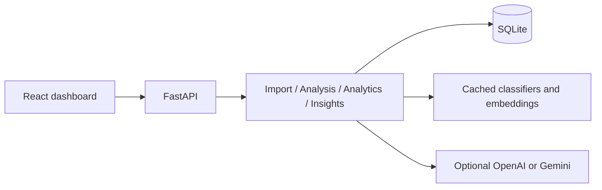

# Architecture
Modular monolith: React/TypeScript/Vite/Tailwind/Recharts UI → FastAPI services → SQLAlchemy/SQLite. ML uses TF-IDF/logistic regression for category and sentiment; cached sentence-transformer embeddings feed cosine DBSCAN. Explicit TF-IDF fallback is available offline. Models train once via CLI and load into a cached service, never per request. SQL persists complaints, batches, clusters, insights, and jobs; embedding cache is keyed by model and text hash.

BackgroundTasks serializes analysis with a process lock (one uvicorn worker). UI polls accurate job status. No queues or remote infrastructure. LLM adapters use HTTPS, timeouts, strict JSON schema validation and existing evidence IDs. Deterministic extractive summaries always work. Training/data paths resolve from repository root; database and model artifacts are ignored.

Local-only service: no authentication. Deployments require auth/RBAC, TLS, backups, encryption, PII scrubbing, audit retention, migration discipline and durable workers.
